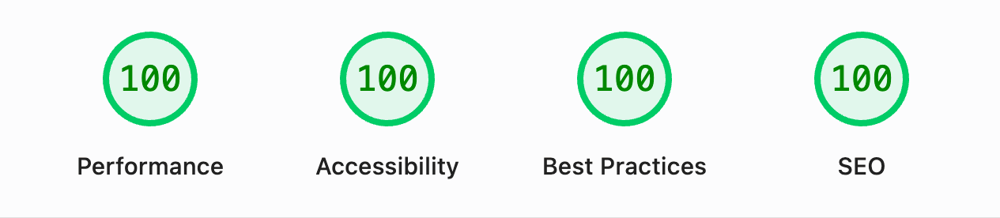

# Features

What a product built on this template can do from its first deploy. Each page says what the feature does for you and where its code starts.

<picture>
  <source media="(prefers-color-scheme: dark)" srcset="../assets/lighthouse-dark.gif">
  <source media="(prefers-color-scheme: light)" srcset="../assets/lighthouse-light.gif">
  
</picture>

## Feature pages

- **[Authentication](auth.md).** Email and password, Google, GitHub, and passkeys, with email verification and role-protected routes. No external auth service.
- **[Billing](billing.md).** Plans, checkout, and usage limits through Autumn on top of Stripe. Users see how much of their quota is left and get an upgrade path.
- **[Admin](admin.md).** Live metrics, user management with impersonation, an audit log, and an email when a customer pays for the first time.
- **[Customer support](support.md).** An AI agent answers questions in a chat on every page and hands the thread to you when a human is needed.
- **[Email](email.md).** Transactional email through Resend, a personal welcome email from you, and incident emails sent only to affected customers.
- **[Internationalization](i18n.md).** Four languages with URL-based routing, translated from committed JSON files.
- **[Analytics](analytics.md).** Opt-in PostHog analytics that loads only after consent and only on the hostnames you list.
- **[Agents and SEO](agents-and-seo.md).** Markdown versions of the marketing pages, `/llms.txt`, social cards, and `hreflang` alternates.
- **[Accessibility](accessibility.md).** Automated WCAG 2.1 AA checks on the main public pages in light and dark mode.

## Also included

**AI chat.** Signed-in users get a streaming AI chat with tool calling and file uploads at `/app/ai-chat`, next to a community chat at `/app/community-chat`. Both count against the [billing](billing.md) quotas.

**Real-time.** Everything updates live: dashboard metrics, the admin users table, community chat, support threads, and AI agent responses streamed token-by-token. Built on Convex reactive queries. Messages, file uploads, and LLM calls are rate-limited via `@convex-dev/rate-limiter` ([`rateLimit.ts`](../../src/lib/convex/rateLimit.ts)).

**User settings.** Users can update their profile, change their password with live strength feedback, swap their email (triggers re-verification), manage passkeys, and review or revoke active sessions. Uploaded avatars and attachments are validated on the server and cleaned up automatically. The page lives in [`app/settings`](../../src/routes/%5B%5Blang%5D%5D/app/settings/).

**Dark mode.** Every component supports light and dark mode via `mode-watcher`. Interactive elements provide subtle haptic feedback on mobile via `web-haptics` (respects `prefers-reduced-motion`).

## Stack

SvelteKit and Svelte 5, Convex, Better Auth, Autumn, Resend, Tolgee, and Bun. The stack is deliberately opinionated, following [Rich Harris's case](https://www.youtube.com/watch?v=SmHgtyym6OA&t=2388s) for smart defaults that fit well together.
